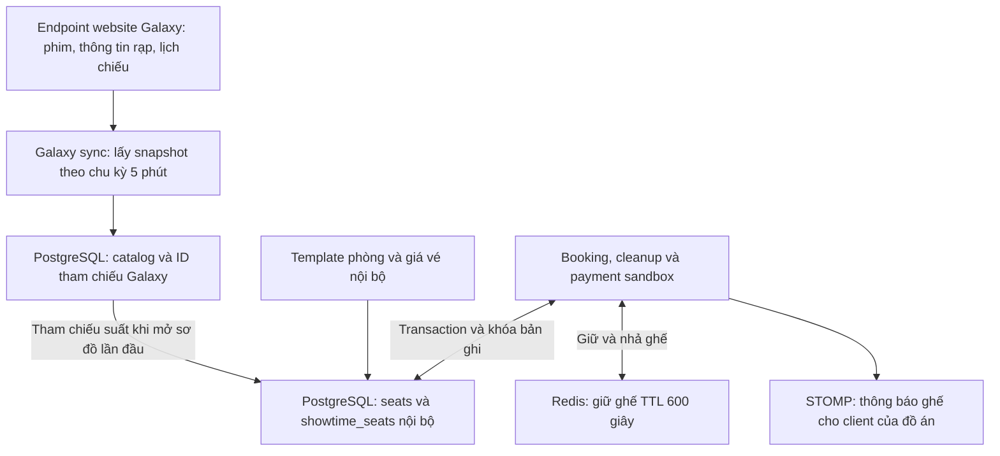

Tài liệu kiến trúc kỹ thuật (Single Source of Truth) cho dự án **Hệ thống Đặt vé Xem phim (High-Concurrency Movie Ticket Booking System)**.

---

## 0. Ranh giới tích hợp Galaxy và nguồn dữ liệu có thẩm quyền

Dự án đồng bộ **catalog gần thời gian thực** từ Galaxy và vận hành **kho ghế,
đơn hàng và thanh toán thử nghiệm độc lập**. Không có luồng giữ ghế hoặc xác
nhận vé tại Galaxy; vé QR của đồ án không có giá trị sử dụng tại rạp Galaxy.



- Galaxy cung cấp dữ liệu tham chiếu cho phim, rạp/phòng xuất hiện trong lịch
  chiếu và thời gian suất chiếu. Các ID nguồn được lưu riêng; ID nội bộ tiếp
  tục được dùng cho booking, Redis key và WebSocket topic.
- `seats` mô tả sơ đồ mô phỏng do đồ án tạo, không phải sơ đồ Galaxy được kiểm
  chứng. `showtime_seats` lưu trạng thái, giá, người giữ và hạn giữ của đồ án;
  đồng bộ catalog không tạo hoặc ghi đè kho ghế. Dịch vụ nội bộ chỉ khởi tạo
  ghế khi mở sơ đồ một suất lần đầu, có khóa suất/phòng để ngăn tạo trùng.
- Bộ nhập bỏ qua `totalSeat`/`bookedSeat` của nguồn. Số ghế đã đặt tổng hợp không
  xác định được từng ghế và không thể bảo đảm đặt chỗ xuyên hai hệ thống.
- Luồng giữ ghế hiện dùng Redis `SET NX` với TTL và PostgreSQL
  `FOR UPDATE NOWAIT`; `ShowtimeSeat` có thêm `@Version`. WebSocket phục vụ cập
  nhật giao diện nội bộ theo sự kiện; PostgreSQL quyết định kết quả giao dịch.
- Chỉ snapshot online đầy đủ mới được dùng để ẩn suất Galaxy đã gỡ. Suất đã có
  đơn bị đổi giờ, hoặc suất đổi phim/phòng, được ẩn để quản trị viên kiểm tra;
  không tự chuyển vé, xóa booking hoặc ghi lại trạng thái ghế.
- Chu kỳ 5 phút là `fixedDelay` sau khi lần trước kết thúc, không phải cam kết
  độ trễ tối đa. Khả năng cập nhật phụ thuộc dữ liệu API cung cấp, kết nối và
  lần đồng bộ thành công gần nhất; không gán tỷ lệ “100%/95%” khi chưa đo lường.

Xem [GALAXY_SYNC.md](backend/cinema-booking-backend/GALAXY_SYNC.md) để cấu hình,
kiểm tra trạng thái và hiểu giới hạn tích hợp. Muốn đặt vé trên kho ghế thật
của Galaxy cần tích hợp được ủy quyền với hệ thống quản lý ghế và giao dịch của
Galaxy; chỉ đọc dữ liệu từ website không cung cấp quyền ghi này.

---

## 1. Thiết kế Cơ sở dữ liệu (Database Schema - DBML)

Thiết kế sử dụng **PostgreSQL**, tách biệt rõ ràng giữa cấu hình vật lý của phòng chiếu (`seats`) và trạng thái ghế theo từng suất chiếu (`showtime_seats`) để tối ưu hóa việc đánh khóa (Locking) và truy vấn.

```dbml
// Cú pháp DBML - Có thể dán trực tiếp vào dbdiagram.io

Enum user_role {
  CUSTOMER
  ADMIN
}

Enum movie_status {
  COMING_SOON
  NOW_SHOWING
  ENDED
}

Enum seat_type {
  STANDARD
  VIP
  COUPLE
}

Enum showtime_seat_status {
  AVAILABLE
  LOCKED
  BOOKED
}

Enum booking_status {
  PENDING
  CONFIRMED
  CANCELLED
  EXPIRED
}

Enum payment_status {
  PENDING
  SUCCESS
  FAILED
  REFUNDED
}

Table users {
  id bigserial [pk]
  email varchar(255) [unique, not null]
  password_hash varchar(255) [not null]
  full_name varchar(100) [not null]
  phone varchar(20)
  role user_role [default: 'CUSTOMER', not null]
  created_at timestamp [default: `now()`]
}

Table movies {
  id bigserial [pk]
  galaxy_movie_id varchar(100) [unique] // ID tham chiếu nguồn, null với phim tạo thủ công
  galaxy_slug varchar(255)
  title varchar(255) [not null]
  description text
  duration_minutes int [not null]
  release_date date [not null]
  poster_url varchar(500)
  landscape_url varchar(500)
  trailer_url varchar(500)
  genre varchar(500)
  country varchar(255)
  directors jsonb // Mảng tên đạo diễn
  actors jsonb // Mảng tên diễn viên
  galaxy_details_synced_at timestamptz
  galaxy_details_attempt_at timestamptz
  age_rating varchar(10) // P, C13, C16, C18
  status movie_status [default: 'COMING_SOON', not null]
  created_at timestamp [default: `now()`]
  
  Indexes {
    status
    release_date
  }
}

Table cinemas {
  id bigserial [pk]
  galaxy_cinema_id varchar(100) [unique] // ID tham chiếu nguồn
  name varchar(255) [not null]
  address text [not null]
  city varchar(100) [not null]
}

Table auditoriums {
  id bigserial [pk]
  cinema_id bigint [ref: > cinemas.id, not null]
  name varchar(100) [not null] // VD: Phòng chiếu 01, IMAX
  total_rows int [not null]
  total_cols int [not null]
}

Table seats {
  id bigserial [pk]
  auditorium_id bigint [ref: > auditoriums.id, not null]
  row_char varchar(5) [not null] // A, B, C...
  seat_number int [not null] // 1, 2, 3...
  type seat_type [default: 'STANDARD', not null]
  is_active boolean [default: true] // Phục vụ bảo trì ghế hỏng
  
  Indexes {
    (auditorium_id, row_char, seat_number) [unique]
  }
}

Table showtimes {
  id bigserial [pk]
  galaxy_session_id varchar(100) [unique] // Không dùng thay ID nội bộ của booking/ghế
  is_active boolean [default: true, not null] // Ẩn suất bị gỡ, giữ nguyên lịch sử vé
  movie_id bigint [ref: > movies.id, not null]
  auditorium_id bigint [ref: > auditoriums.id, not null]
  start_time timestamp [not null]
  end_time timestamp [not null]
  base_price decimal(10,2) [not null]
  
  Indexes {
    (movie_id, start_time)
    (auditorium_id, start_time)
  }
}

// BẢNG TRỌNG TÂM XỬ LÝ CONCURRENCY
Table showtime_seats {
  id bigserial [pk]
  showtime_id bigint [ref: > showtimes.id, not null]
  seat_id bigint [ref: > seats.id, not null]
  price decimal(10,2) [not null] // Giá đã cộng phụ thu VIP/Couple
  status showtime_seat_status [default: 'AVAILABLE', not null]
  locked_by_user_id bigint [ref: > users.id, null]
  locked_until timestamp [null]
  version int [default: 0, not null] // Phục vụ Optimistic Locking (@Version trong JPA)
  
  Indexes {
    (showtime_id, seat_id) [unique]
    (showtime_id, status)
  }
}

Table products {
  id bigserial [pk]
  name varchar(255) [not null] // Combo Bắp Nước 1, Pepsi L...
  description text
  price decimal(10,2) [not null]
  image_url varchar(500)
  is_available boolean [default: true]
}

Table bookings {
  id bigserial [pk]
  booking_code varchar(20) [unique, not null] // Mã vé ngắn gọn tạo QR
  user_id bigint [ref: > users.id, not null]
  showtime_id bigint [ref: > showtimes.id, not null]
  total_amount decimal(12,2) [not null]
  status booking_status [default: 'PENDING', not null]
  qr_code_url varchar(500)
  created_at timestamp [default: `now()`]
  expires_at timestamp [not null]
  
  Indexes {
    booking_code
    (user_id, created_at)
    (status, expires_at) // Phục vụ Cronjob quét đơn hết hạn
  }
}

Table booking_seats {
  id bigserial [pk]
  booking_id bigint [ref: > bookings.id, not null]
  showtime_seat_id bigint [ref: > showtime_seats.id, not null]
  price decimal(10,2) [not null]
  
  Indexes {
    (booking_id, showtime_seat_id) [unique]
  }
}

Table booking_products {
  id bigserial [pk]
  booking_id bigint [ref: > bookings.id, not null]
  product_id bigint [ref: > products.id, not null]
  quantity int [not null]
  unit_price decimal(10,2) [not null]
}

Table payments {
  id bigserial [pk]
  booking_id bigint [ref: > bookings.id, not null]
  transaction_no varchar(100) [unique] // Mã giao dịch từ VNPay/MoMo
  payment_method varchar(50) [not null] // VNPAY, MOMO
  amount decimal(12,2) [not null]
  status payment_status [default: 'PENDING', not null]
  paid_at timestamp
}

```

---

## 2. Kiến trúc xử lý Concurrency & Giữ ghế 10 phút (Redis + PostgreSQL)

Để chịu tải cao (hàng nghìn người cùng vào chọn ghế giờ cao điểm) và đảm bảo tính toàn vẹn dữ liệu tuyệt đối (ACID), hệ thống áp dụng chiến lược **Two-Layer Locking (Khóa 2 tầng)**: **Redis Distributed Lock** làm phễu chặn ở tầng bộ nhớ đệm (In-Memory) và **PostgreSQL Optimistic/Pessimistic Locking** chốt chặn ở tầng lưu trữ bền vững (Persistent Storage).

### 2.1. Luồng đọc sơ đồ ghế (Read Path)

1. Frontend gọi API lấy sơ đồ ghế của `showtime_id`.
2. Backend truy vấn danh sách `showtime_seats` từ DB (hoặc từ Redis Cache nếu đã cache).
3. Backend dựng danh sách key `seat_lock:{showtime_id}:{showtime_seat_id}` cho các ghế `AVAILABLE` đang xét và đọc một lần bằng Redis `MGET`. Ghế có key giữ chỗ được trả về `LOCKED`; ghế `BOOKED`/`LOCKED` trong DB được giữ nguyên. Không quét toàn bộ keyspace bằng `KEYS`.

### 2.2. Luồng Giữ ghế & Tạo đơn hàng (Write Path - Giữ chỗ 10 phút)

Khi User bấm "Tiếp tục thanh toán" với danh sách ghế `[seat_1, seat_2]`:

* **Bước 1: Sắp xếp ID ghế (Chống Deadlock)**
* Backend bắt buộc sort mảng `showtime_seat_id` theo thứ tự tăng dần trước khi lock (VD: `[101, 102]`).


* **Bước 2: Tầng 1 - Khóa phân tán trên Redis (Fast-Fail)**
* Sử dụng lệnh nguyên tử (Atomic) của Redis (hoặc Lua Script / Redisson MultiLock) đối với từng ghế:
`SET seat_lock:{showtime_id}:{showtime_seat_id} {user_id} NX EX 600` (TTL = 600 giây = 10 phút).
* **Cơ chế:** `NX` (Not Exists) đảm bảo nếu có 1000 request cùng bắn vào 1 ghế tại 1 mili-giây, **chỉ đúng 1 request nhận được `OK**`, 999 request còn lại nhận `nil` và bị từ chối ngay lập tức tại tầng Redis mà không làm nghẽn kết nối xuống PostgreSQL.
* Nếu bất kỳ ghế nào trong danh sách bị lock thất bại -> Rollback (Xóa các key Redis vừa tạo thành công trước đó của request này) và trả về lỗi `409 Conflict` ("Ghế đã có người nhanh tay hơn chọn").


* **Bước 3: Tầng 2 - Khóa và cập nhật trên PostgreSQL (DB Transaction)**
* Mở `@Transactional` trong Spring Boot.
* Query kiểm tra kèm **Pessimistic Write Lock** (`SELECT ... FOR UPDATE NOWAIT`) hoặc dùng **Optimistic Locking** (thông qua cột `version` với `@Version` trong JPA):
```sql
SELECT * FROM showtime_seats 
WHERE id IN (101, 102) AND status = 'AVAILABLE' 
FOR UPDATE NOWAIT;

```


* Nếu số bản ghi trả về khác số lượng ghế yêu cầu -> Ném Exception, Rollback DB, xóa key Redis.
* Nếu hợp lệ:
1. Cập nhật `showtime_seats`: `status = 'LOCKED'`, `locked_by_user_id = {user_id}`, `locked_until = NOW() + 10 mins`.
2. Tạo bản ghi bảng `bookings` (`status = 'PENDING'`, `expires_at = NOW() + 10 mins`).
3. Lưu chi tiết ghế vào `booking_seats` và bắp nước vào `booking_products`.


* Commit Transaction và tạo URL thanh toán (VNPay/MoMo) trả về cho Client.


### 2.3. Luồng Xử lý Thanh toán (Webhook IPN) & Nhả ghế (Release Path)

* **Trường hợp 1: Thanh toán thành công (VNPay/MoMo gọi IPN Webhook)**
1. Kiểm tra chữ ký số (Checksum/Signature) từ cổng thanh toán.
2. Mở DB Transaction, lock bản ghi `bookings` (`FOR UPDATE`).
3. Lưu ý **Edge Case (Thanh toán trễ ở phút thứ 10:01)**:
* Nếu `booking.status == 'PENDING'`: Cập nhật `booking.status = 'CONFIRMED'`, `showtime_seats.status = 'BOOKED'`, xóa key `seat_lock` trên Redis. Phát sự kiện (Spring ApplicationEvent / RabbitMQ / Kafka) để sinh mã QR và gửi Email bất đồng bộ.
* Nếu `booking.status == 'EXPIRED'` (Cronjob vừa hủy đơn ngay trước khi IPN tới): Kiểm tra xem các ghế của đơn đó hiện tại có còn `AVAILABLE` không. Nếu còn trống -> Vẫn cho `CONFIRMED` và `BOOKED`. Nếu ghế đã bị người khác lock/mua -> Chuyển trạng thái thanh toán sang `REFUND_REQUIRED` để hoàn tiền tự động/thủ công.


* **Trường hợp 2: Người dùng chủ động hủy hoặc Thanh toán thất bại**
* Cập nhật `bookings.status = 'CANCELLED'`, trả `showtime_seats.status = 'AVAILABLE'`, xóa key trên Redis.


* **Trường hợp 3: Treo máy / Tắt trình duyệt (Hết hạn 10 phút)**
* Key trên Redis tự động biến mất sau 600s nhờ cơ chế TTL.
* Tại Backend, cấu hình một `@Scheduled` (chạy mỗi 30 giây): Quét các `bookings` có `status = 'PENDING'` và `expires_at < NOW()` để chuyển về `'EXPIRED'`, đồng thời giải phóng `showtime_seats` về `'AVAILABLE'`.


---

## 3. Danh sách RESTful API cốt lõi

Quy ước chung:

* Base URL: `/api/v1`
* Định dạng phản hồi chuẩn: `{ "code": 200, "message": "Success", "data": { ... } }`
* Bảo mật: Sử dụng `Bearer <JWT_Token>` trên Header `Authorization`.

### Module 1: Auth & User

| Method | Endpoint | Mô tả | Quyền |
| --- | --- | --- | --- |
| `POST` | `/auth/register` | Đăng ký tài khoản mới | Public |
| `POST` | `/auth/login` | Đăng nhập, trả về Access Token & Refresh Token | Public |
| `POST` | `/auth/refresh` | Làm mới Access Token | Public |
| `GET` | `/users/me` | Lấy thông tin cá nhân của user đang đăng nhập | Authenticated |
| `GET` | `/users/me/bookings` | Lấy lịch sử đặt vé của người dùng | Authenticated |

### Module 2: Catalog (Phim, Rạp, Lịch chiếu, Bắp nước)

| Method | Endpoint | Mô tả | Quyền |
| --- | --- | --- | --- |
| `GET` | `/movies` | Danh sách phim (Filter: `status`, `genre`, `keyword`, phân trang) | Public |
| `GET` | `/movies/{id}` | Chi tiết phim + Trailer | Public |
| `GET` | `/cinemas` | Danh sách cụm rạp (Filter theo `city`) | Public |
| `GET` | `/showtimes` | Lấy lịch chiếu (Query params: `movieId`, `cinemaId`, `date`) | Public |
| `GET` | `/showtimes/{id}/seats` | Lấy sơ đồ ghế và trạng thái ghế real-time của 1 suất chiếu | Public |
| `GET` | `/products` | Lấy danh sách combo bắp nước đang mở bán | Public |

### Module 3: Booking & Payment (Core Flow)

| Method | Endpoint | Mô tả | Quyền |
| --- | --- | --- | --- |
| `POST` | `/bookings` | **API giữ ghế & tạo đơn**: Nhận `showtimeId`, `seatIds[]`, `products[]`. Thực thi lock Redis + DB. | Customer |
| `GET` | `/bookings/{bookingCode}` | Xem chi tiết đơn hàng & trạng thái vé (kèm QR code nếu đã thanh toán) | Customer |
| `DELETE` | `/bookings/{bookingCode}/cancel` | Hủy giữ chỗ chủ động khi người dùng bấm quay lại/hủy đơn | Customer |
| `POST` | `/payments/create-url` | Tạo URL thanh toán chuyển hướng sang VNPay / MoMo Sandbox | Customer |
| `GET` | `/payments/vnpay-ipn` | Webhook (IPN) để server VNPay gọi ngầm xác nhận kết quả giao dịch | Public (Verify Hash) |
| `POST` | `/payments/momo-ipn` | Webhook (IPN) để server MoMo gọi ngầm xác nhận kết quả giao dịch | Public (Verify Hash) |

### Module 4: AI Chatbot

| Method | Endpoint | Mô tả | Quyền |
| --- | --- | --- | --- |
| `POST` | `/chat/ask` | Gửi câu hỏi của user. Backend kết hợp LLM (OpenAI/Gemini API) + Function Calling/RAG truy vấn lịch chiếu & phim đang chiếu để tư vấn. | Public |

### Module 5: Admin Portal (Quản trị & Thống kê)

| Method | Endpoint | Mô tả | Quyền |
| --- | --- | --- | --- |
| `POST` | `/admin/movies` | Thêm phim mới (kèm `PUT`, `DELETE` theo `{id}`) | Admin |
| `POST` | `/admin/cinemas` | Tạo rạp và phòng chiếu (`auditoriums`) | Admin |
| `POST` | `/admin/auditoriums/{id}/seats/batch` | Khởi tạo/Cập nhật hàng loạt sơ đồ ghế (ma trận hàng/cột, loại ghế) | Admin |
| `POST` | `/admin/showtimes` | Xếp lịch chiếu mới (Tự động kiểm tra trùng giờ chiếu tại cùng phòng chiếu và sinh dữ liệu bảng `showtime_seats`) | Admin |
| `CRUD` | `/admin/products` | Quản lý danh mục bắp nước | Admin |
| `GET` | `/admin/reports/revenue` | Thống kê doanh thu theo khoảng thời gian, theo phim, hoặc theo cụm rạp | Admin |
| `GET` | `/admin/reports/occupancy` | Thống kê tỷ lệ lấp đầy phòng chiếu (Occupancy Rate) | Admin |

---

## 4. Điểm nhấn Kiến trúc cần lưu ý khi Implement (Best Practices cho CV)

1. **Idempotency (Tính lũy đẳng) tại Webhook Thanh toán:** Cổng thanh toán VNPay/MoMo có thể gọi lại IPN nhiều lần nếu mạng chập chờn. API `/payments/*-ipn` bắt buộc kiểm tra nếu `payment.status == 'SUCCESS'` thì trả về mã thành công ngay lập tức mà không xử lý lặp lại logic cộng tiền hay gửi lại email.
2. **Real-time Seat Updates (Tùy chọn nâng cao):** Tích hợp **Spring WebSocket (STOMP)** để mỗi khi có 1 user giữ ghế thành công (`POST /bookings`) hoặc nhả ghế, Server broadcast sự kiện tới topic `/topic/showtimes/{showtimeId}/seats` để các màn hình người dùng khác đang mở cùng suất chiếu thấy ghế đó đổi màu ngay lập tức mà không cần F5.
3. **Async Processing:** Việc render ảnh mã QR (dùng thư viện `ZXing`), upload lên Cloudinary/S3 và gửi Email (JavaMailSender) phải được đẩy vào `@Async` hoặc Message Queue để không làm chậm thời gian phản hồi của luồng thanh toán.
